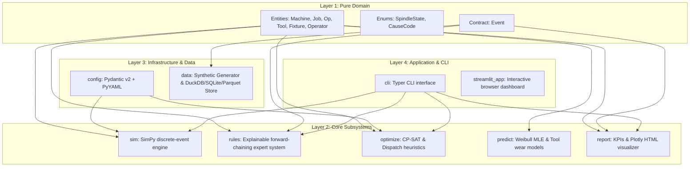
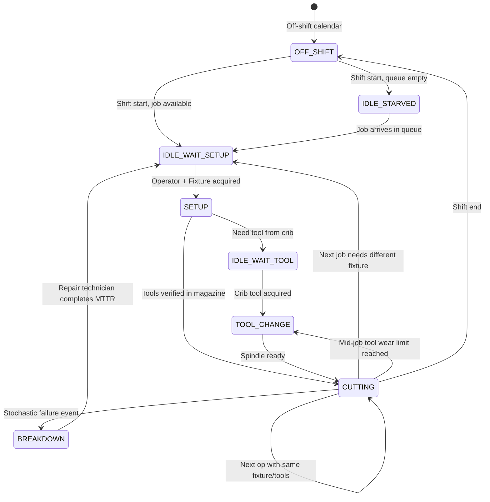

# System Architecture: CNC VMC Shop Floor Digital Twin

## 1. Architectural Style: Hexagonal (Ports & Adapters)

The CNC VMC Shop Floor Digital Twin is designed around a strictly decoupled **Hexagonal Architecture** with four distinct layers:

---

## 2. Layer Isolation Rules

1. **Pure Domain Core (`src/vmc_twin/domain/`)**:
   - Zero dependencies on third-party frameworks.
   - Contains dataclasses with slots, immutable value objects, and pure domain enums.
2. **Core Subsystems (`src/vmc_twin/{sim, rules, optimize, predict, report}/`)**:
   - Depend **only** on `domain`.
   - Never import directly from sibling core subsystems (e.g., `rules` never imports `sim`; `optimize` never imports `rules`).
   - Sibling communication is achieved through domain value objects and the immutable `Event` log.
3. **Infrastructure (`src/vmc_twin/{config, data}/`)**:
   - Handles external I/O, file reading, validation, and database queries.
4. **Application (`src/vmc_twin/{cli.py, streamlit_app}/`)**:
   - Composition root wiring adapters to ports.

---

## 3. Event-Driven Lifecycle & State Transitions

A VMC machine process traverses discrete states driven by resource availability and schedule requirements:

---

## 4. Key Architecture Decision Records (ADRs)

- **ADR-0001**: Hexagonal Architecture & Zero Circular Imports
- **ADR-0002**: Immutable Event Contract as Primary System Bus
- **ADR-0003**: OR-Tools CP-SAT as Primary Exact Finite-Capacity Scheduler
- **ADR-0004**: Custom Pure-Python Forward-Chaining Rule Engine
- **ADR-0005**: Polars & DuckDB as Local In-Process Analytical Engine
- **ADR-0006**: Local File-Based Experiment Tracking
